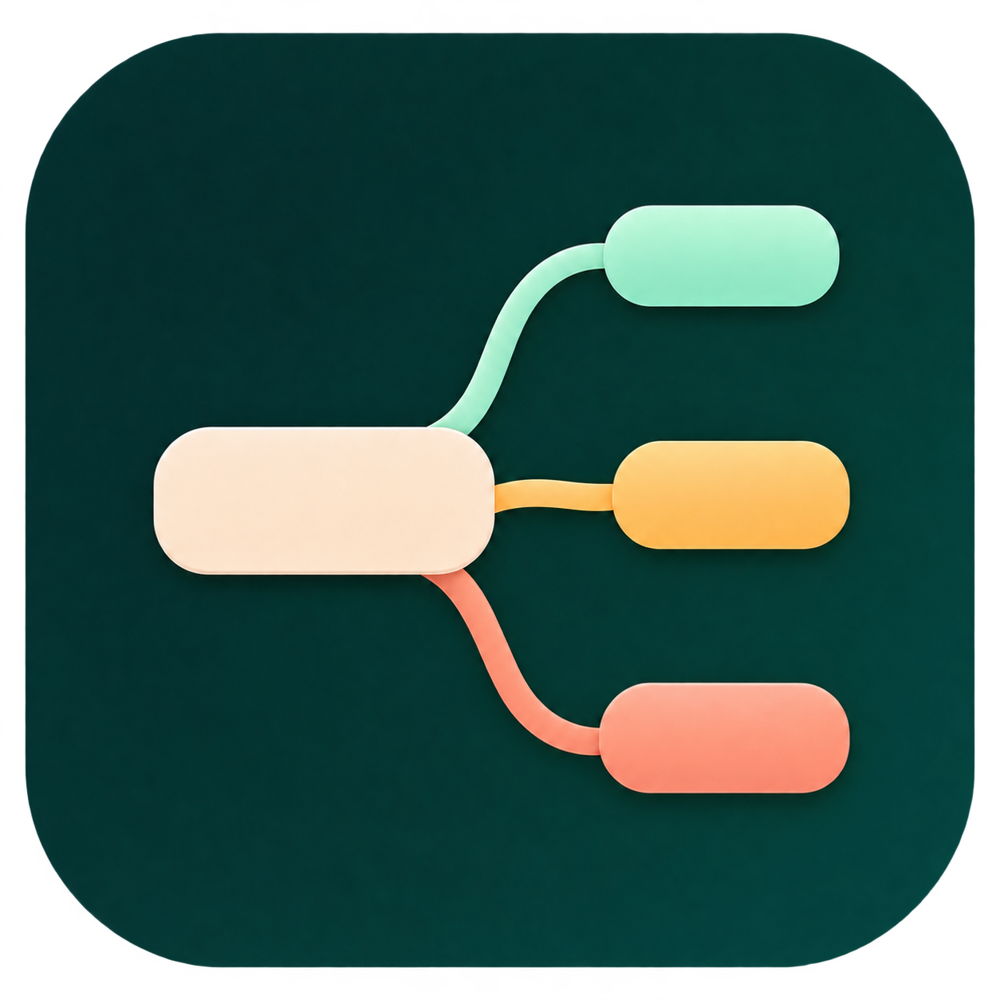
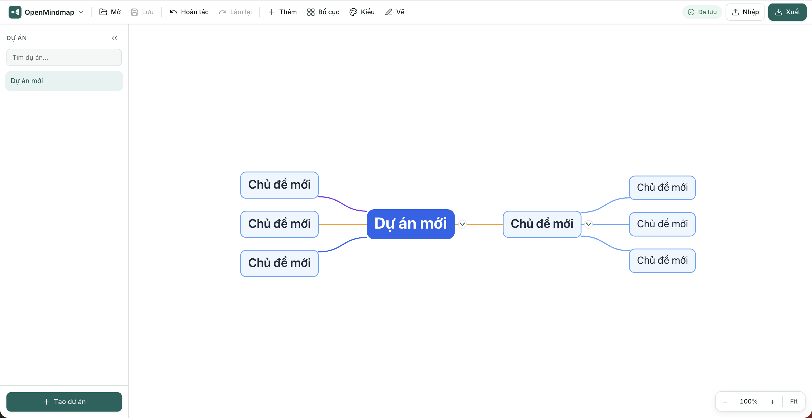

# OpenMindmap

OpenMindmap là ứng dụng mind map chạy cục bộ trên macOS và trình duyệt.

  

## Xem trước giao diện

## Tải bản cài macOS

**Apple Silicon (arm64), phiên bản 0.2.1**

- [Tải OpenMindmap-0.2.1-arm64.dmg](https://github.com/teakay1311/OpenMindmap/releases/download/v0.2.1/OpenMindmap-0.2.1-arm64.dmg)
- [Tải checksum SHA-256](https://github.com/teakay1311/OpenMindmap/releases/download/v0.2.1/OpenMindmap-0.2.1-arm64.dmg.sha256)
- [Xem ghi chú phát hành](https://github.com/teakay1311/OpenMindmap/releases/tag/v0.2.1)

Yêu cầu hệ thống được khai báo là macOS 13.5 trở lên và máy Mac Apple Silicon. Bản cài 0.2.1 được ký ad hoc, chưa được notarize bởi Apple. macOS có thể hiện cảnh báo khi mở lần đầu. Chỉ mở bản tải từ Release chính thức sau khi kiểm tra checksum. Xem [hướng dẫn của Apple về mở ứng dụng tải từ Internet](https://support.apple.com/en-us/102445).

### Cài đặt

1. Mở tệp DMG trong Finder.
2. Kéo OpenMindmap.app vào Applications.
3. Mở ứng dụng từ Applications.

Đối chiếu checksum trong cùng thư mục tải về:

~~~sh
shasum -a 256 -c OpenMindmap-0.2.1-arm64.dmg.sha256
~~~

Checksum xác nhận tệp tải về khớp với Release, không xác nhận danh tính nhà phát triển hay trạng thái notarization.

## Chức năng

- Tạo và quản lý sơ đồ, chỉnh sửa node, nhánh, ghi chú, hình ảnh, biểu tượng, checkbox, ngày và liên kết.
- Sắp xếp sơ đồ theo các bố cục và chủ đề màu có sẵn.
- Vẽ, tạo nối chéo, tìm kiếm, thay thế, hoàn tác và làm lại.
- Nhập JSON, Markdown, OPML và TXT.
- Xuất JSON, Markdown, OPML, TXT, SVG, PNG và PDF.

## Dữ liệu và sao lưu

Dữ liệu được lưu cục bộ trong hồ sơ của môi trường đang chạy ứng dụng. Bản macOS dùng vùng lưu trữ riêng của WebKit trong ứng dụng. Bản trình duyệt dùng vùng lưu trữ của hồ sơ trình duyệt. Hai môi trường này không tự đồng bộ với nhau và ứng dụng không cung cấp dịch vụ đồng bộ đám mây.

Để sao lưu hoặc chuyển một sơ đồ, dùng **Xuất → JSON**, rồi nhập tệp JSON ở môi trường đích. Tệp JSON có thể chứa toàn bộ nội dung sơ đồ, ảnh nhúng và metadata liên quan. Hãy lưu tệp sao lưu ở nơi phù hợp.

## Chạy từ mã nguồn

Yêu cầu Bun 1.3.14 và Node.js 26.10.0. Từ thư mục dự án:

~~~sh
bun install --frozen-lockfile
bun run db:generate
bun run dev
~~~

Mở http://localhost:3000. Để chạy kiểm tra:

~~~sh
bun run lint
./node_modules/.bin/tsc --noEmit --incremental false
bun test tests
bun run build
~~~

bun run db:generate chỉ tạo Prisma Client theo schema. Không dùng db:push, db:migrate hay db:reset để chạy các bước trên.

### Đóng gói ứng dụng macOS

Đóng gói yêu cầu máy Mac Apple Silicon, Xcode Command Line Tools, Bun 1.3.14 và Node.js 26.10.0 arm64.

Tải Node.js từ trang phân phối chính thức, rồi kiểm SHA-256 của archive trước khi giải nén:

~~~sh
curl -fLO https://nodejs.org/dist/v26.10.0/node-v26.10.0-darwin-arm64.tar.gz
echo '751fdf7439f115d87ee2a8f3f18c065b6151852068e3e666ac60ac2996f75ac9  node-v26.10.0-darwin-arm64.tar.gz' | shasum -a 256 -c -
tar -xzf node-v26.10.0-darwin-arm64.tar.gz
export OPENMINDMAP_NODE_BIN="$PWD/node-v26.10.0-darwin-arm64/bin/node"
bun run build
./macos/build-mac-app.sh --dmg dist/OpenMindmap-0.2.1-arm64.dmg
~~~

Lệnh đóng gói từ chối ghi đè đầu ra có cùng tên. Kết quả được ký ad hoc và không được notarize tự động. Tệp Node.js runtime không được lưu trong Git, nhưng được nhúng trong ứng dụng macOS sau khi kiểm tra phiên bản và kiến trúc.

## Định dạng dữ liệu

Schema Project V3 được lưu tại [docs/project-format-v3.schema.json](docs/project-format-v3.schema.json). Chỉ các trường được hỗ trợ bởi định dạng đích mới được giữ khi xuất sang Markdown, OPML hoặc TXT.

## Giấy phép

Mã nguồn OpenMindmap được cấp phép theo Apache License 2.0. Xem [LICENSE](LICENSE). Font Inter và Node.js được phân phối theo giấy phép riêng, xem [THIRD_PARTY_NOTICES.md](THIRD_PARTY_NOTICES.md). Các dependency khác giữ nguyên giấy phép riêng của chúng.

## Phát hiện vấn đề

Tạo issue trong [GitHub Issues](https://github.com/teakay1311/OpenMindmap/issues) và ghi phiên bản ứng dụng, phiên bản macOS, các bước tái hiện cùng kết quả mong đợi. Không đính kèm sơ đồ thật, thông tin đăng nhập hoặc dữ liệu riêng tư.
